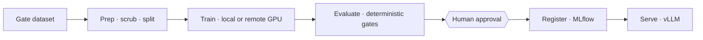

<p align="center">
  <picture>
    <source media="(prefers-color-scheme: dark)" srcset="./assets/logo-dark.svg">
    
  </picture>
</p>

<h1 align="center">cairn</h1>

<p align="center">
  <b>Cairn runs your AI and ML pipelines behind budgets, policy, approvals and an audit trail.</b><br>
  Fine-tune, evaluate, promote, and serve models as single governed commands —
  cost-capped before the GPU spins up, policy-gated, and audited.
</p>

<p align="center">
  <a href="https://docs.cairndev.sh"></a>
  <a href="https://cairndev.sh"></a>
  <a href="https://demo.cairndev.sh"></a>
  <a href="https://github.com/cairndev-sh/cairn/actions/workflows/ci.yml?query=branch%3Amain"></a>
  <a href="https://github.com/cairndev-sh/cairn/actions/workflows/quickstart.yml?query=branch%3Amain"></a>
  <a href="https://cairndev-sh.github.io/cairn/"></a>
  <a href="https://pypi.org/project/cairndev/"></a>
  <a href="https://pypi.org/project/cairndev/"></a>
  <a href="./LICENSE"></a>
</p>

<p align="center">
  <a href="https://docs.cairndev.sh">Docs</a> ·
  <a href="https://demo.cairndev.sh">Live demo</a> ·
  <a href="https://docs.cairndev.sh/install/">Install</a> ·
  <a href="https://docs.cairndev.sh/reference/catalog/">Pipeline catalog</a> ·
  <a href="https://docs.cairndev.sh/concepts/gates/">Gates and approvals</a> ·
  <a href="https://github.com/cairndev-sh/cairn-extensions">Extensions</a> ·
  <a href="https://github.com/cairndev-sh/cairn/discussions">Discussions</a> ·
  <a href="https://discord.gg/CPyC6bzTJW">Discord</a>
</p>

<p align="center">
  <sub>The live demo runs a web console that isn't part of this repository. <a href="#what-cairndev-includes">What <code>cairndev</code> includes</a>.</sub>
</p>

---

## What is cairn?

cairn runs the work behind AI as **governed commands**. You declare an
outcome — gate a dataset, fine-tune a model, evaluate it against a baseline,
promote it, serve it — and cairn drives the tools underneath, enforces the
guardrails, and records exactly what ran.

The engine is **domain-neutral**. Everything that knows about a *domain* lives
in a **pack**; everything that touches a *tool* is an **operator**. The engine
never imports a pack — that one-way dependency is what lets the same machinery
run fine-tuning, dataset checks, model evaluation, or incident response, and
lets any operator inherit the budget, policy gate, and audit for free.

cairn is **open source** (Apache 2.0) and **self-hosted**: your keys, your
GPUs, your logs — nothing leaves your perimeter.

## What cairndev includes

`pip install cairndev` gives you the engine, the `cairn` command, the API server
(`cairn-server`), the client (`cairn-client`) and the builtin operator packs, under
Apache 2.0. Domain packs and more operator packs are separate Apache 2.0 wheels from
[cairn-extensions](https://github.com/cairndev-sh/cairn-extensions).

The web console, and the operator packs for GPU providers and managed training, are
part of cairn-platform. Everything in the [docs](https://docs.cairndev.sh) runs on the
open-source packages, unless a page says otherwise. The [live demo](https://demo.cairndev.sh) runs that console, so
it shows things you won't get from `pip install cairndev`.

## Extensions

Domain packs and the operators they use are separate wheels, released from
[**cairn-extensions**](https://github.com/cairndev-sh/cairn-extensions). Install
the ones you need next to `cairndev`:

| Package | What it adds |
|---|---|
| [`cairn-pack-dataset-prep`](https://github.com/cairndev-sh/cairn-extensions/tree/main/packs/cairn-pack-dataset-prep) | Pin a dataset, audit and clean it, split it by group and register `train` / `val` / `test` versions |
| [`cairn-pack-finetune`](https://github.com/cairndev-sh/cairn-extensions/tree/main/packs/cairn-pack-finetune) | LoRA / QLoRA fine-tuning on a GPU box over SSH, with approvals, a priced budget, base-vs-candidate evaluation and a box that starts after approval and stops on every outcome |
| [Operator packs](https://github.com/cairndev-sh/cairn-extensions#packages) | Dataset checks, training, lm-evaluation-harness benchmarks, IFC validation, and the contract wheels they implement |

```bash
pip install cairndev cairn-pack-finetune
```

Walkthrough: [Fine-tune a model](https://docs.cairndev.sh/guides/fine-tune-a-model/).

## Why governed?

This is what separates cairn from a bare agent loop or a black-box tool — the
work runs behind deterministic guardrails you can inspect afterward:

- **Budget cap** — a template's model calls stop at its `budget.max_cost_usd`, or at the
  deployment's `MAX_COST_USD` ($1 by default) if that's lower: the call that crosses the cap
  has been paid for, calls already in flight can pass it further, the leg fails, and the pipeline stops. A flow checks its own
  `budget.max_cost_usd` between stages, and a leg in a series reserves its estimate first.
- **Holdout door** — a training dataset version that shares rows with a registered test set
  is refused at launch, and the refusal names the rows.
- **Policy + human approval** — proposed actions pass declarative policy rules
  before any executor runs; high-risk ones (promote a model, destroy a
  resource) pause for a human and resume durably from a checkpoint.
- **Recorded runs** — every run on an engine stores its inputs, the operator, flow or
  template it ran, and its events. `cairn status <run-id> --replay` prints them. It doesn't
  execute anything again: it shows what happened, and doesn't reproduce the result.
- **Tamper-evident audit** — with `audit.sink` bound, approvals and every governed
  pipeline step land in a hash-chained, append-only log: what ran, what it cost, who
  approved it. So do direct model completions and `mcp/call` tool calls; a template's own
  prompt and agent nodes don't write a row yet. The quickstart's profile, the
  `secure` profile and the Compose stack bind it; `local-dev` leaves it off. It catches edits that leave the hashes alone, not someone who can rewrite the file: see [what it detects and what it doesn't](https://docs.cairndev.sh/concepts/runs/#verify-the-audit-trail).
- **Citation validation** — for synthesized answers, every identifier the model
  cites is exact-string-matched against its context; unmatched citations are
  stripped.

## Proof it works

Every number here comes from a script you can run yourself, and each result records what it was
measured on: see [`benchmark/`](./benchmark/README.md).

<!-- benchmark:begin (generated by benchmark/render.py; do not edit) -->

**What the audit log detects, and what it can't** ([reproduce](./benchmark/audit_tamper.py))

| Measured | Result |
|---|---|
| The untouched log, 23 rows, with `cairn admin audit verify` | verifies: exit 0 |
| The untouched log against its own head, with `cairn admin lineage --expect-head` | matches: exit 0 |
| The same, without `--json`, on a log with no lineage records | matches: exit 0 |
| Changed who gave an approval, row 11 | detected: exit 2, row 11 (hash) |
| Deleted that row | detected: exit 2, row 11 (prev_hash) |
| Inserted a forged approval before it, correctly linked, so the row after the forgery breaks | detected: exit 2, row 12 (prev_hash) |
| Swapped it with the next row | detected: exit 2, rows 11, 12, 13 (prev_hash) |
| Limit: appended a forged approval at the end, correctly linked | NOT detected by the chain: exit 0. Against a saved head: exit 2, the same answer a log that only grew gets |
| Limit: cut the last 3 rows | NOT detected by the chain: exit 0. Detected only against a head saved outside the log (`--expect-head`): exit 2 |
| Limit: emptied the file | NOT detected by the chain: exit 0. Detected only against a head saved outside the log (`--expect-head`): exit 2 |
| Limit: changed row 11 and recomputed every hash after it | NOT detected by the chain: exit 0. Detected only against a head saved outside the log (`--expect-head`): exit 2 |
| Limit: changed row 1 and recomputed every hash in the file | NOT detected by the chain: exit 0. Detected only against a head saved outside the log (`--expect-head`): exit 2 |
| Limit: rows written after a head was saved, then cut | NOT detected, even with that head: exit 0 |
| Limit: a head saved earlier, on a log that has grown since | reported as a mismatch: exit 2. The saved head has to be the latest one |
| Cut the last 3 rows, with `--expect-head` given an empty or blank value | refused, nothing compared: exit 2 |
| Cut the last 3 rows and tried values in the new last row until its hash began with the first 4 characters of the saved head | a prefix that short is refused: exit 2. With the full saved head: exit 2 |

cairndev 0.5.0, `uv.lock` `b71bfd534f0d`, Linux x86_64 with 4 CPUs and Python 3.13.13, 2026-11-03.

**How far past a cost cap a template's spend gets** ([reproduce](./benchmark/budget_overshoot.py))

| Runtime | Template | Cap | Spend recorded | Past the cap | Calls the model received | Leg and pipeline |
|---|---|---|---|---|---|---|
| in-process | 6 calls in a row | $0.000070 | $0.000084 | $0.000014 (20%) | 3 of 6 | failed, next leg never started |
| in-process | 8 calls at once | $0.000040 | $0.000224 | $0.000184 (460%) | 8 of 8 | failed, next leg never started |
| DBOS on SQLite | 6 calls in a row | $0.000070 | $0.000084 | $0.000014 (20%) | 3 of 6 | failed, next leg never started |
| DBOS on SQLite | 8 calls at once | $0.000040 | $0.000224 | $0.000184 (460%) | 8 of 8 | failed, next leg never started |
| Temporal | not measured | n/a | n/a | n/a | n/a | n/a |

A cap can't take back the call that crosses it, so calls in a row pass it by at most one call. Here that's half a call, and it's 20% only because this test's cap is just 2.5 calls.

Calls sent at once can pass a cap by nearly all of them: all 8 reached the model before any answer came back, and the second answer is the one that crosses this cap. The percentage depends on how many calls there are and how small the cap is. A call answered after the run stops could be paid for without being counted. These runs didn't show that, but it would make the recorded spend too low.

Temporal isn't measured, because this script needs a Temporal server. From the code, the worker only meters, so the run should fail when it ends, with its calls already made.

cairndev 0.5.0, `uv.lock` `b71bfd534f0d`, Linux x86_64 with 4 CPUs and Python 3.13.13, 2026-11-03.

**What happens when the server is killed** ([reproduce](./benchmark/crash_matrix.py))

| Storage | Runtime | Bus | Killed at a person gate | Killed inside a flow leg | Killed inside a template leg on DBOS |
|---|---|---|---|---|---|
| SQLite | in-process | in-process | still waiting, then finishes | fails closed, not resumed | n/a |
| SQLite | in-process | Postgres | still waiting, then finishes | fails closed, not resumed | n/a |
| SQLite | DBOS | in-process | still waiting, then finishes | fails closed, not resumed | resumes, then finishes |
| SQLite | DBOS | Postgres | still waiting, then finishes | fails closed, not resumed | resumes, then finishes |
| Postgres | in-process | in-process | still waiting, then finishes | fails closed, not resumed | n/a |
| Postgres | in-process | Postgres | still waiting, then finishes | fails closed, not resumed | n/a |
| Postgres | DBOS | in-process | still waiting, then finishes | fails closed, not resumed | resumes, then finishes |
| Postgres | DBOS | Postgres | still waiting, then finishes | fails closed, not resumed | resumes, then finishes |

Each entry is what that cell's test required and saw in this run. Of these cells, only the template leg on DBOS resumes; a flow leg killed on the builtin engine fails, and so does its pipeline. What each cell checks, where this holds, and what no cell tests: [What happens when the server is killed](./benchmark/README.md#what-happens-when-the-server-is-killed).

cairndev 0.5.0, `uv.lock` `b71bfd534f0d`, Linux x86_64 with 4 CPUs and Python 3.13.13, 2026-11-03.

**The quickstart's path on a local engine** ([reproduce](./benchmark/quickstart_path.py))

| Measured | Result |
|---|---|
| Engine start to answering | 3.3 s |
| Launch to a pipeline paused at its person gate | 1.9 s (median of 5, after one warm-up run) |
| Both approvals to a finished pipeline, nobody waiting | 1.0 s (median of 5, after one warm-up run) |
| Nothing published before the person gate | held on all 6 runs |
| A false data gate stops the pipeline before any later step starts, and is logged | held |
| Each decision a person made is in the audit log with the signed-in user | held for all 12 decisions |
| Audit chain verifies at the end | held (143 rows) |

cairndev 0.5.0, `uv.lock` `b71bfd534f0d`, Linux x86_64 with 4 CPUs and Python 3.13.13, 2026-11-03.

<!-- benchmark:end -->

## Quickstart

Run a governed pipeline on your machine: it checks a dataset, stops at a gate for
you, and writes a hash-chained audit trail. No API key, no spend, about ten minutes.

```bash
curl -LsSf https://docs.cairndev.sh/install.sh | CAIRN_EXTRAS=hello sh   # or: pip install 'cairndev[hello]'
mkdir cairn-quickstart && cd cairn-quickstart
curl -LsSfO https://raw.githubusercontent.com/cairndev-sh/cairn/main/examples/hello-cairn/profiles/hello.toml
export CAIRN_PROFILE=$PWD/hello.toml                        # the example's profile: audit trail on

cairn setup --port 8471                                     # local engine on SQLite, signed in as dev
cairn run hello-cairn/profile-and-publish --preset sample --environment sandbox
```

The pipeline profiles the file, passes its **data gate** (the profile must pass and
count at least 10 rows), redacts and versions the file, and stops at `review`, a
**person gate**:

```text
  paused
    profile            done                 run=run-task-data--profile-1f9a14
    data-ok            done                 run=None
    redact             done                 run=run-task-redact--text-85ecfb
    engine-check       done                 run=run-flow-hello-cairn--engine-check-55b570
    stage              done                 run=run-task-storage--put-1295cd
    review             awaiting_approval    run=None
    promote            pending              run=None
    publish            pending              run=None
    audit              pending              run=None
  gate review  (approvers: data-owners)
    profile.verdict       pass
    profile.record_count  20
    …
→ approve   cairn decide pl_3f5b6ec6a25d414d approve --step review --approver you
→ findings  cairn status pl_3f5b6ec6a25d414d --results
→ watch     cairn status pl_3f5b6ec6a25d414d --follow
Approve this step? [a]pprove / [r]eject / [s]kip (detach)
```

Answer `a`, then `a` again at `promote`, the gate the operator itself adds. With `s`, or with
no terminal to ask on, the pipeline stays waiting, and these answer from any shell. The last
one reads the record:

```bash
cairn decide <pipeline_id> approve --step review     # the person gate
cairn decide <pipeline_id> approve --step promote    # the operator's own gate
cairn status <pipeline_id> --results                 # what every leg produced
```

```text
pipeline pl_3f5b6ec6a25d414d  status=done
  …
  promote  [done] run=run-task-artifact--promote-3b4d2f
    artifact_id           sha256:d2c09d27b2874cee
    tag                   hello-sample@published
  audit  [done] run=run-task-audit--store-39b32a
    hash  af362a96212cf0d5298dfe71e81b5109d08a0219f3079387550e753f2fa25466
```

`cairn status <pipeline_id> --json` prints the whole record as JSON: the plan, the
inputs, and every step's state and decision. The audit trail is in `./audit.jsonl`:
rows for the launch, each step, each decision a person made, with the signed-in user
(`pipeline.gate_approved`), and the row the pipeline's own `audit` step writes. Each
row is chained to the one before it by its hash, and `cairn admin audit verify` checks the
file. Try `-i min_rows=1000` to watch the data gate stop the pipeline before any later
step starts. The full walkthrough is the [Quickstart](https://docs.cairndev.sh/quickstart/);
to look around without installing, use the live demo at https://demo.cairndev.sh (a
shared sandbox, so don't enter real credentials). It runs a web console that isn't part
of this repository ([what `cairndev` includes](#what-cairndev-includes)).

To watch a budget refuse a run, with no key and no spend, start a pipeline whose estimate
is above its cap:

```bash
cairn run hello-cairn/over-budget --environment sandbox
```

```text
pipeline_id=pl_592c6c850aec40a5 status=running
  failed
    engine-check       failed               run=run-flow-hello-cairn--engine-check-78f6c9
  engine-check: series 'hello-over-budget': this run's estimate $5.00 would exceed the $1.00 cap ($0.00 spent, $0.00 reserved by in-flight runs). Raise the budget or start a new series.
→ logs      cairn status run-flow-hello-cairn--engine-check-78f6c9 --logs   # leg engine-check
→ findings  cairn status pl_592c6c850aec40a5 --results
```

The flow leg's reservation failed, so its engine never started, and the command exits 1. The
$5 is a figure the pipeline file declares, not a measured price, and the flow itself would cost
nothing. The refusal is the real one every flow leg under a `series` goes through. This pipeline
needs the release after cairndev 0.4.0. See [Cost and budgets](https://docs.cairndev.sh/concepts/cost/).

From source:

```bash
git clone https://github.com/cairndev-sh/cairn && cd cairn
uv sync --extra dev
CAIRN_PACK_PATH=examples/hello-cairn uv run cairn run --dry-run hello-cairn/profile-and-publish
```

The engine ships as the `cairndev` distribution (import name `cairn`), carrying the
builtin operator packs and the core contracts; the container image is built from
`Dockerfile.engine` and the Helm chart lives under `deploy/helm/cairn`. Optional
extras and team setup: [Install and deploy](https://docs.cairndev.sh/install/) ·
[CLI reference](https://docs.cairndev.sh/reference/cli/).

## The ModelOps lifecycle

Each stage is a normal governed run; chained together they form one auditable
spine — as a template's subgraphs, or as an explicit
[pipeline](https://docs.cairndev.sh/concepts/pipelines/).



Deterministic gates decide pass/fail; LLM judges are advisory and off by
default. Promotion pauses for a human. The shipped pipelines are listed in the
[pipeline catalog](https://docs.cairndev.sh/reference/catalog/).

## One engine, many surfaces

The same governed core is driven from two places in this repository:

- **CLI** — the full control surface: run, preflight, replay, approve, deploy.
  → [CLI reference](https://docs.cairndev.sh/reference/cli/)
- **HTTP + SSE API** — every control-plane action is an endpoint, including live
  run streaming.

## Documentation

| | |
|---|---|
| [Overview](https://docs.cairndev.sh/) | What cairn is and the governance thesis |
| [Architecture](./docs/architecture/00-overview.md) | Engine, packs, profiles, request lifecycle |
| [Write a pipeline](https://docs.cairndev.sh/guides/write-a-pipeline/) · [Capabilities and operators](https://docs.cairndev.sh/concepts/capabilities/) | Packs, and how operators pick up a provider |
| [Gates and approvals](https://docs.cairndev.sh/concepts/gates/) · [Cost and budgets](https://docs.cairndev.sh/concepts/cost/) | Policies, HITL gates, budget, audit |
| [Gate CI on a check](https://docs.cairndev.sh/guides/gate-ci/) | Fail a pull request on a bad dataset with `cairn run --check` |
| [Pipelines](https://docs.cairndev.sh/concepts/pipelines/) | Chain governed workflows with gates and events |
| [Install and deploy](https://docs.cairndev.sh/install/) | Install, Docker Compose, Helm, sign-in |
| [Operators catalog](https://docs.cairndev.sh/reference/operators/) | Every shipped operator, by domain |

## Contributing

Start with [`CONTRIBUTING.md`](./CONTRIBUTING.md): the dev loop, where each kind of test
lives, and the DCO sign-off every commit needs. Self-contained starting points are
labelled [`good first issue`](https://github.com/cairndev-sh/cairn/labels/good%20first%20issue).

<a href="https://github.com/cairndev-sh/cairn/graphs/contributors">
  
</a>

## Status & license

cairn is in **early access** and under active development. The API and command
surface may still change between releases; see [`CHANGELOG.md`](./CHANGELOG.md).

Licensed under the **Apache License 2.0** — see [`LICENSE`](./LICENSE).
Contributions are welcome: read [`CONTRIBUTING.md`](./CONTRIBUTING.md) first.
