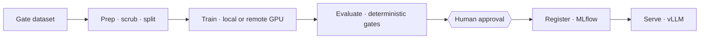

<p align="center">
  <picture>
    <source media="(prefers-color-scheme: dark)" srcset="./assets/logo-dark.svg">
    
  </picture>
</p>

<h1 align="center">cairn</h1>

<p align="center">
  <b>An open-source control plane for governed ModelOps.</b><br>
  Fine-tune, evaluate, promote, and serve models as single governed commands —
  cost-capped before the GPU spins up, policy-gated, and audited end to end.
</p>

<p align="center">
  <a href="https://docs.cairndev.sh"></a>
  <a href="https://cairndev.sh"></a>
  <a href="https://demo.cairndev.sh"></a>
  <a href="https://github.com/cairndev-sh/cairn/actions/workflows/ci.yml?query=branch%3Amain"></a>
  <a href="https://pypi.org/project/cairndev/"></a>
  <a href="https://pypi.org/project/cairndev/"></a>
  <a href="./LICENSE"></a>
</p>

<p align="center">
  <a href="https://docs.cairndev.sh">Docs</a> ·
  <a href="https://demo.cairndev.sh">Live demo</a> ·
  <a href="https://docs.cairndev.sh/install/">Install</a> ·
  <a href="https://docs.cairndev.sh/reference/catalog/">Pipeline catalog</a> ·
  <a href="https://docs.cairndev.sh/concepts/gates/">Gates and approvals</a> ·
  <a href="https://github.com/cairndev-sh/cairn-extensions">Extensions</a>
</p>

---

## What is cairn?

cairn runs the work behind AI as **governed commands**. You declare an
outcome — gate a dataset, fine-tune a model, evaluate it against a baseline,
promote it, serve it — and cairn drives the tools underneath, enforces the
guardrails, and records exactly what ran.

The engine is **domain-neutral**. Everything that knows about a *domain* lives
in a **pack**; everything that touches a *tool* is an **operator**. The engine
never imports a pack — that one-way dependency is what lets the same machinery
run fine-tuning, dataset checks, model evaluation, or incident response, and
lets any operator inherit the budget, policy gate, and audit for free.

cairn is **open source** (Apache 2.0) and **self-hosted**: your keys, your
GPUs, your logs — nothing leaves your perimeter.

## Extensions

Domain packs and the operators they use are separate wheels, released from
[**cairn-extensions**](https://github.com/cairndev-sh/cairn-extensions). Install
the ones you need next to `cairndev`:

| Package | What it adds |
|---|---|
| [`cairn-pack-dataset-prep`](https://github.com/cairndev-sh/cairn-extensions/tree/main/packs/cairn-pack-dataset-prep) | Pin a dataset, audit and clean it, split it by group and register `train` / `val` / `test` versions |
| [`cairn-pack-finetune`](https://github.com/cairndev-sh/cairn-extensions/tree/main/packs/cairn-pack-finetune) | LoRA / QLoRA fine-tuning on a GPU box over SSH, with approvals, a priced budget, base-vs-candidate evaluation and a box that starts after approval and stops on every outcome |
| [Operator packs](https://github.com/cairndev-sh/cairn-extensions#packages) | Dataset checks, training, lm-evaluation-harness benchmarks, IFC validation, and the contract wheels they implement |

```bash
pip install cairndev cairn-pack-finetune
```

Walkthrough: [Fine-tune a model](https://docs.cairndev.sh/guides/fine-tune-a-model/).

## Why governed?

This is what separates cairn from a bare agent loop or a black-box tool — the
work runs behind deterministic guardrails you can inspect afterward:

- **Hard budget** — every run accrues cost in a scope; over the cap it raises
  `BudgetExceeded`, so a fine-tune can't quietly overspend.
- **Policy + human approval** — proposed actions pass declarative policy rules
  before any executor runs; high-risk ones (promote a model, destroy a
  resource) pause for a human and resume durably from a checkpoint.
- **Reproducible runs** — every run stores its validated inputs, a content-
  addressed schema hash, and the exact operators it resolved to. Replay any run;
  explain any result.
- **Tamper-evident audit** — every model call, tool call, and approval lands in
  a hash-chained, append-only log: what ran, what it cost, who approved it.
- **Citation validation** — for synthesized answers, every identifier the model
  cites is exact-string-matched against its context; unmatched citations are
  stripped.

## Quickstart

Run a governed pipeline on your machine: it checks a dataset, stops at a gate for
you, and writes an audit row. No API key, no spend, about ten minutes.

```bash
curl -LsSf https://docs.cairndev.sh/install.sh | CAIRN_EXTRAS=hello sh   # or: pip install 'cairndev[hello]'
mkdir cairn-quickstart && cd cairn-quickstart
curl -LsSfO https://raw.githubusercontent.com/cairndev-sh/cairn/main/examples/hello-cairn/data/sample.jsonl

cairn dev --engine-only --port 8471 &                       # local engine on SQLite
cairn remote login -u dev -p dev -e http://localhost:8471
cairn remote launch hello-cairn/profile-and-publish \
  -i path=$PWD/sample.jsonl --environment sandbox --watch
```

The pipeline profiles the file, passes its **data gate** (the profile must pass and
count at least 10 rows), redacts and versions the file, and stops at `review`, a
**person gate**:

```text
  paused
    profile            done                 run=run-task-data--profile-1f9a14
    data-ok            done                 run=None
    redact             done                 run=run-task-redact--text-85ecfb
    engine-check       done                 run=run-flow-hello-cairn--engine-check-55b570
    stage              done                 run=run-task-storage--put-1295cd
    review             awaiting_approval    run=None
    promote            pending              run=None
    publish            pending              run=None
    audit              pending              run=None
⏸ paused — 1 step(s) waiting on a human
```

Approve it, then the promotion the operator itself gates, and read the record:

```bash
cairn remote advance <pipeline_id> review     # the person gate
cairn remote advance <pipeline_id> promote    # the operator's own gate
cairn remote findings <pipeline_id>           # what every leg produced
```

```text
pipeline pl_3f5b6ec6a25d414d  status=done
  …
  promote  [done] run=run-task-artifact--promote-3b4d2f
    artifact_id           sha256:d2c09d27b2874cee
    tag                   hello-sample@published
  audit  [done] run=run-task-audit--store-39b32a
    hash  af362a96212cf0d5298dfe71e81b5109d08a0219f3079387550e753f2fa25466
```

`cairn remote pipeline <pipeline_id>` prints the whole record as JSON: the plan, the
inputs, and every step's state and decision. The audit row lands in `./audit.jsonl`,
chained to the row before it by its hash. Try
`-i min_rows=1000` to watch the data gate stop the pipeline before anything is
written. The full walkthrough is the [Quickstart](https://docs.cairndev.sh/quickstart/);
to look around without installing, use the live demo at https://demo.cairndev.sh (a
shared sandbox, so don't enter real credentials).

From source:

```bash
git clone https://github.com/cairndev-sh/cairn && cd cairn
uv sync --extra dev
CAIRN_PACK_PATH=examples/hello-cairn uv run cairn pipeline explain hello-cairn/profile-and-publish
```

The engine ships as the `cairndev` distribution (import name `cairn`), carrying the
builtin operator packs and the core contracts; the container image is built from
`Dockerfile.engine` and the Helm chart lives under `deploy/helm/cairn`. Optional
extras and team setup: [Install and deploy](https://docs.cairndev.sh/install/) ·
[CLI reference](https://docs.cairndev.sh/reference/cli/).

## The ModelOps lifecycle

Each stage is a normal governed run; chained together they form one auditable
spine — as a template's subgraphs, or as an explicit
[pipeline](https://docs.cairndev.sh/concepts/pipelines/).



Deterministic gates decide pass/fail; LLM judges are advisory and off by
default. Promotion pauses for a human. The shipped pipelines are listed in the
[pipeline catalog](https://docs.cairndev.sh/reference/catalog/).

## One engine, many surfaces

The same governed core is driven from two places in this repository:

- **CLI** — the full control surface: run, preflight, replay, approve, deploy.
  → [CLI reference](https://docs.cairndev.sh/reference/cli/)
- **HTTP + SSE API** — every control-plane action is an endpoint, including live
  run streaming.

## Documentation

| | |
|---|---|
| [Overview](https://docs.cairndev.sh/) | What cairn is and the governance thesis |
| [Architecture](./docs/architecture/00-overview.md) | Engine, packs, profiles, request lifecycle |
| [Write a pipeline](https://docs.cairndev.sh/guides/write-a-pipeline/) · [Capabilities and operators](https://docs.cairndev.sh/concepts/capabilities/) | Packs, and how operators pick up a provider |
| [Gates and approvals](https://docs.cairndev.sh/concepts/gates/) · [Cost and budgets](https://docs.cairndev.sh/concepts/cost/) | Policies, HITL gates, budget, audit |
| [Pipelines](https://docs.cairndev.sh/concepts/pipelines/) | Chain governed workflows with gates and events |
| [Install and deploy](https://docs.cairndev.sh/install/) | Install, Docker Compose, Helm, sign-in |
| [Operators catalog](https://docs.cairndev.sh/reference/operators/) | Every shipped operator, by domain |

## Contributing

Start with [`CONTRIBUTING.md`](./CONTRIBUTING.md): the dev loop, where each kind of test
lives, and the DCO sign-off every commit needs. Self-contained starting points are
labelled [`good first issue`](https://github.com/cairndev-sh/cairn/labels/good%20first%20issue).

<a href="https://github.com/cairndev-sh/cairn/graphs/contributors">
  
</a>

## Status & license

cairn is in **early access** and under active development. The API and command
surface may still change between releases; see [`CHANGELOG.md`](./CHANGELOG.md).

Licensed under the **Apache License 2.0** — see [`LICENSE`](./LICENSE).
Contributions are welcome: read [`CONTRIBUTING.md`](./CONTRIBUTING.md) first.
