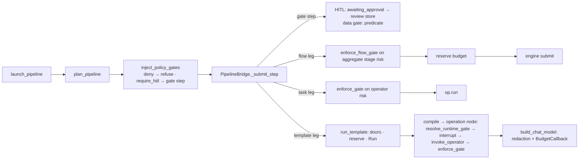

# Governance — approval, policy, budget, redaction, audit, admission doors

The product thesis (`README.md`): "enforcement is a function others call, never a block
others copy." This document lists each enforcement function, who calls it, and whether
every execution path reaches it (OBSERVED at HEAD `81d876ae`; the 2026-08-13 audit
`docs/audits/chokepoint-reachability-2026-08-13.md` is the DOCUMENTED baseline).

## The chokepoints

| Guarantee | Function | Callers (OBSERVED) | Reach |
|---|---|---|---|
| **Approval gate** (ADR-0034): a gated operator cannot run without an `ApprovalRecord` | `enforce_gate` `src/cairn/core/approval/enforce.py:116`; decision = `resolve_runtime_gate` `:88` → `resolver.py:76 resolve_gate` (pure; sources: operator `risk`/`requires_approval` from installed manifest, `[profile.approval]`, binding strictness-only, the PolicyEngine) | `operator/runtime.py:950` (every `invoke_operator`), `dispatch/pipeline_bridge.py:1332` (task legs), `engine/compiler.py:1591` (operation node pre-check → LangGraph `interrupt()` at `:1610`), `engine/pipeline_explain.py` (dry) | agentic ✔ · task legs ✔ · flow legs: **`enforce_flow_gate`** `enforce.py:173` at `pipeline_bridge.py:1121` on the flow's aggregated risk (whole-flow, not per stage — ADR-0089 R2) |
| **Policy** (YAML rules → `deny > require_hitl > require_dry_run > allow_auto`) | `PolicyEngine.evaluate` `policy/engine.py:176`; ONE cached runtime instance `approval/policy_source.py:61 runtime_policy_engine` | resolver (per operation), `Runner.run` (legacy whole-run actions), policy preview routes | per-operation ✔; per-flow-leg via risk class ✔; **plan-time structural gates** `policy/pipeline_gates.py:93 inject_policy_gates` at `pipeline_launch.py:277` (deny raises before any record exists) ✔ |
| **Budget** | `budget_reservations.py` `reserve / settle / release` (fleet-shared, Postgres-backed since #1530); per-LLM-call `record_llm` `obs/cost.py:44` + `BudgetCallback` `services/llm/factory.py:69` → `BudgetExceeded`; wall-clock `run_within_budget` `engine/runner.py:45` | `dispatcher.py:966` (run admission), `leg_executor.py:401` (flow leg, only when `series_id` set; a leg on a priced `compute.ssh` box reserves the estimate recorded at launch and settles `hourly_usd × wall-clock` on every outcome, ADR-0151 D5), `pipeline_launch.py:478` (launch door: priced legs' estimate vs `remaining_usd`, read-only; untimed priced leg refused, ADR-0151 D2/D3) | agentic runs ✔ · flow legs ✔ · **task legs: no reservation found** (`grep reserve(` → only dispatcher + leg executor) — PARTIAL |
| **Redaction** (ADR-0028) | `Redactor` bound via profile `redact.text`; `obs/redact.py:129 redact_messages`; **the chokepoint is the chat-model constructor** `services/llm/factory.py:97 build_chat_model` returning `RedactingChatOpenAI` (#1376) | every LangChain-driven call (templates, chat, ask); `llm/client.py:126 llm_complete` | CONFIRMED by `tests/core/test_llm_redaction_chokepoint.py` (bind_tools, tool results, streaming); unbound = identity |
| **Audit** (ADR-0028) | `obs/audit.py:137 audit_emit` → bound `audit.sink` operator (hash-chained JSONL by default), `NullAuditSink` when unbound; fail-safe | `llm/client.py:228` (`llm_complete`, operator/stage LLM calls), `engine/compiler.py:1676` (agentic gate *decision*, after `interrupt()`), `model_license_gate.py:132`, `dispatch/schedule_catchup.py:207`, `operators/builtins/mcp/…/call.py:59` (`tool.call`); platform: `cairn_platform/actions/durable.py:120`, `cairn_platform/console/artifacts_api.py:83`, `cairn_platform/routers/ask.py:55`; plus pack operation nodes that call the `audit/store` operator directly (e.g. `packs/training/operations/run-cost-audit.yaml`) (OBSERVED 2026-10-14) | PARTIAL by design (only "security-relevant seams"); pipeline lifecycle audits go to `PipelineBridge._audit` → bus/events, not the sink (DOCUMENTED 08-13) |
| **Admission doors** (fail-closed refusals before a record exists) | `holdout.py check_holdout_for_inputs`, `intake.py check_intake_for_inputs`, `model_license_gate.py check_license_for_inputs`, `job_channel_door.py`, `dataflow/engine_door.py`, `pull_worker_door.py`, `pack/provisioning.py` | `RunDispatcher.run_template` (`dispatcher.py:737,835-879`), `preflight.py`, and once per pipeline launch `decide_admission` (`src/cairn/core/admission_door.py`, #2190) with the policies' `admission.required_checks` and the inputs' declared `role` / `verdict: required` (ADR-0146), followed by the `pipeline.launching` run hook, through which an installed provider may refuse the launch (fails closed; `src/cairn/core/pack/run_hooks.py`) | agentic runs via dispatcher ✔ · flow legs: dataset refs resolved in `execute_leg` (`leg_executor.py:171-191`) · **CLI `cairn run <pack>/<template>` compiles and runs in-process (`cli/commands/run.py:341`) without these doors** — see Conflicts |
| **Workspace boundary** | `_WorkspaceMiddleware` `triggers/server.py:451` + `assert_workspace_allowed` (`workspace.py`); re-asserted at every workspace write/execute route by `Depends(writable_workspace)` (`triggers/console_support.py`, #221 — defence in depth, the middleware stays the check; on run event ingest a per-run worker token is left to the guard's run scoping, `writable_workspace_unless_worker`) | every HTTP route; the workspace write routes twice. NOT the pull lane (`/jobs/claim`, `/jobs/{id}/heartbeat`): no workspace; a credential rule instead (`routers/jobs.py _is_worker_credential`): only the env admin or a worker-pool token (`scope=worker-pool`, `cairn remote worker-token`; the auth guard limits it to those two routes) claims or heartbeats, a per-run worker token heartbeats only its own run's job, a user's token gets 403 (`test_jobs_claim_worker_credential.py`) | CONFIRMED (`tests/core/test_workspace_boundary.py`, `test_write_route_workspace_guard.py`) when auth is on |
| **Auth** | JWT middleware `triggers/auth.py` (token and password helpers in `core/auth_tokens.py`; the console's refresh cookie, rotation and sign-out in `core/refresh_tokens.py` + `POST /auth/refresh`/`/auth/logout`, ADR-0142); enforced iff `CAIRN_JWT_SECRET` set. Deployment-level writes (`POST /registry/install`, `/registry/uninstall`) need the env admin (`require_admin` + `console_support.require_deployment_admin`); a saga decision (`POST /triggers/approve/{id}`) needs the caller's account to own the saga's workspace, which the action handler reports through `workspace_of` (else env admin only; `ingress.py _assert_may_decide_saga`, `test_registry_admin_and_saga_scope.py`) | all non-public routes | ⚠ AUTH-ON is a different app than keyless; `require_admin` coverage of governance-config writes was flagged in `docs/audits/architecture-audit-2026-08-21.md` (#1486) — DOCUMENTED, not re-verified here |
| **Deterministic guards** | `guards/citation_validator.py`, `guards/critique.py` | compiler (prompt/state-machine nodes) | incident-era; scope limited to templates that enable them |
| **In-flow risk** | `dataflow/defs.py:116 stage_risk_class`, `:176 aggregate_risk` (unknown → `external_write`, warns) | flow leg gate, compile-time | CONFIRMED (`test_inflow_policy_boundary.py`) |

**Where a pipeline's decisions are recorded** (owner decision 2026-10-14, #2536: document, do not add events). The hash-chained audit log is written by the callers in the Audit row above, and directly by the platform demo seed (`cairn_platform/showcase_seed.py:707 _seed_audit`, sample rows for `cairn demo`) (OBSERVED). Three things are easy to miss. An agentic template's own prompt and agent nodes call models through `build_chat_model` (`services/llm/factory.py:97`), which redacts and budgets but writes **no** audit row; only `llm_complete` calls are audited (`llm/client.py:228`). An agentic gate is audited when it is decided, not when it is requested (`engine/compiler.py:1676`). And a pipeline's own gate decisions are not written to the log at all (OBSERVED). Their trail is:

- the `PipelineRecord`: each step's status, verdict, approver and timestamps (`storage/pipeline_store.py:47` `StepState`, `:77`);
- the reviews table: one record per human gate with `gate_snapshot`, `status` (open | approved | rejected), `reviewer` and `rationale` (`storage/reviews.py:40-67`). Review writes are best-effort and need `CAIRN_STORAGE` set; without it the store is a null store (OBSERVED);
- each leg's `Run` and its run events.

**Who may decide a pipeline gate** (#2393, owner decision 2026-10-15). A gate's `approvers:`
(step first, else `governance.approvers` — ONE rule, `engine/pipeline_gate.py required_approvers`,
shared with the queue row the approver sees) is enforced at the approve door
`POST /pipelines/{id}/steps/{step}/approve` in `triggers/routers/pipelines.py _assert_may_decide`,
before anything is recorded (`/advance` refuses an `awaiting_approval` step with 409 for everyone,
#2388, so a gate has one door). The scope is a **declared gate step** (`step.approval`, the only step
that gets a queue row with an audience): a manual release (`awaiting_advance`), a clock or topic wait
(`awaiting_schedule` / `awaiting_event`) and a leg a policy parked mid-flight (no gate context) keep
today's behaviour. The rule is `approval/enforce.py approver_allowed` (pure): a value names a **username**
or a **role** (`owner` / `admin` / `member`); an owner/admin may always decide; a name that is
neither matches nobody, so that gate is owner/admin-only (fail closed). Every shipped pack names a
group (`ml-leads`, `data-stewards`, `platform`, `sre-oncall`) and no group concept exists, so
under auth those gates are owner/admin-only until groups arrive (#2589, ADR needed). A gate without
`approvers` and keyless (auth-off) dev are unchanged. A refusal is a 403 naming the required
approvers and IS written to the audit log as `operation.approval` outcome `deny`
(actor, `required`, `role`) — the one pipeline-gate event in the log; an accepted decision still
leaves only the trail above. This route is the only place the audience is checked: the console,
CLI (`cairn remote`), client and MCP all call it, and the Temporal twin only ever receives its
`approve_step` signal from `advance_step`.

`PipelineBridge._audit` (`dispatch/pipeline_bridge.py:2402`) publishes `pipeline.<event>` on the bus as the live signal, not a durable record. A pipeline's legs still produce audit rows whenever they reach one of the seams above, for example a task or flow leg whose operator calls `llm_complete` or `mcp/call`, a template leg's model-licence acceptance or gated-operation decision, or an `audit/store` node; separately, the scheduler audits its catch-up decisions for scheduled pipelines (`dispatch/schedule_catchup.py:207`). `cairn lineage` lists `lineage.record` rows from the audit log (`cli/commands/lineage.py:29`), written through `audit/store` by a lineage-audit node, so it shows nothing for a pipeline without one (OBSERVED).

## Where governance happens on each leg kind (INFERRED summary)

## Owns / does not own
- `approval/` owns the *decision* (`resolver.py` is a pure function) and the *enforcement*; it does not own graph wiring (the compiler does the `interrupt()`), UI (`approval/surface.py` only shapes requests), or storage of decisions (`storage/reviews.py`, run state).
- `policy/` owns rule loading from pack dirs + overlay + store and evaluation; `policy/store.py` owns the console-authored policies; it does not decide *where* gates go except via `pipeline_gates.py`.
- `obs/` owns interfaces + resolution for redaction/audit and the cost scope; detection/storage live in builtin operators (`redact_regex`, `audit_store`).

## State
Cached singletons with reset helpers (tests rely on them): `reset_runtime_policy_engine`,
`reset_redactor`, `reset_audit_sink`, `reset_reservations`. Reservations and approvals are
persisted (Postgres/sqlite); the in-memory tiers are volatile.

## Tests (most important)
`tests/core/test_approval_chokepoint.py`, `test_approval_gate_e2e.py`,
`test_approval_policy_wiring.py`, `test_approval_resolver.py`, `test_leg_approval_gates.py`,
`test_flow_leg_gate_guard.py`, `test_policy_engine.py`, `test_policy_injected_gates.py`,
`test_pipeline_governance_wiring.py`, `test_budget_reservation.py`, `test_starter_budget.py`,
`test_llm_redaction_chokepoint.py`, `test_redact.py`, `test_audit.py`, `test_audit_scope.py`,
`test_workspace_boundary.py`, `test_inflow_policy_boundary.py`.

## Invariants
| Invariant | Classification |
|---|---|
| Governance occurs before execution (gate before dispatch; policy at plan time) | CONFIRMED for pipeline + dispatcher paths |
| One approval mechanism (HITL queue satisfies `enforce_gate`) | CONFIRMED (`README`, `enforce.py`, `test_approval_gate_e2e.py`) |
| A pipeline gate's `approvers:` is enforced at the approve door (username or role; owner/admin always; unknown name → owner/admin only) | CONFIRMED (`routers/pipelines.py _assert_may_decide`, `test_gate_approvers_enforced.py`, #2393) |
| Optional to turn ON, not optional to ESCAPE (redaction/audit) | CONFIRMED by design (`obs/redact.py` docstring; bound → always applied) |
| Budget reserved before spend on every paid leg | **PARTIALLY ENFORCED** — task legs have no reservation site. A flow leg on a priced `compute.ssh` box is estimated at the launch door and refused there when it does not fit, reserves that recorded estimate, and settles its wall-clock on every outcome (ADR-0151 D1–D5, `test_gpu_leg_pricing.py`); box time outside the flow legs (a task leg such as `compute/acquire`, idle time before `release`) is unpriced The cap itself is the pipeline's `governance.budget.usd` bounded by the deployment profile's `[profile.budget]` (`default_usd` for a pipeline that declares none, `ceiling_usd` as the most any launch is capped at; a declared figure above the ceiling runs under it), computed once at the launch door and recorded on `admission.budget`; with `local_hourly_usd` a builtin-engine leg with no target is priced too (ADR-0155) |
| Every entry path goes through the same admission | **PARTIALLY ENFORCED** — CLI local run path bypasses dispatcher doors (see below) |
| Policy at admission and at dispatch never diverge | CONFIRMED by construction (`policy_source.py` builds the engine exactly as `Runner` does) |

## Conflicts
- **CLI dev loop — resolved by ADR-0106 D6.** `cairn run --interactive | --mock | --dry-run`
  compiles (`src/cairn/cli/commands/run.py:341`) and runs the flow in-process and writes no record,
  by decision (`run.py:5-12`). Plain `cairn run <ref>` goes through the governed start, which
  refuses a bare flow ref (`dispatch/start.py:69`, D1). In the dev loop the per-operation gate
  still fires; the admission doors and budget *reservation* do not — the documented shape of a
  dev loop, no longer a DOCUMENTATION / IMPLEMENTATION CONFLICT.
- README says approval is checked on "both the compiled template path and the pipeline
  task-leg path" — CONFIRMED; flow legs are gated on aggregate risk, which README does
  not mention.
