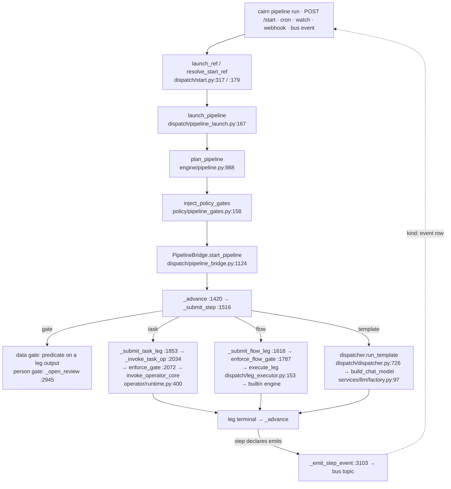

# Golden path — the hello-cairn example (the public feature proof)

## What this workflow does
`examples/hello-cairn` is the public core's feature proof (ADR-0127 D1). It ships four
pipelines, one per pipeline kind a new user meets, and together they exercise every public
feature. Each runs from the CLI or the HTTP API on the public core alone. This page traces
what each one does on its way through the engine; the shared spine is
[pipeline.md](pipeline.md), and this page only names where the example leaves it.

| Pipeline | Kind | Legs, in order | Proves |
|---|---|---|---|
| `profile-and-publish` | data | `data/profile` → data gate `data-ok` → `redact/text` → flow `engine-check` → `storage/put` (stage) → person gate `review` → `artifact/promote` → `storage/put` (publish, `emits: dataset.ready`) → `audit/store` | data gate, person gate, builtin dataflow engine, redaction, artifact store + promote, audit, budget, `watch`/`schedule`/`webhook` triggers, `emits` |
| `ask-the-docs` | agentic | template `assistant` (RAG search → rerank → model call → MCP tool → memory write) → `monitor/threshold` → person gate `review` | LLM through `build_chat_model`, MCP, RAG + vector store, memory, monitor, `kind: event` trigger on `dataset.ready` |
| `tiny-finetune` | ml | `data/profile` → data gate → flow `lora` (`train/lora` stage) → `train/eval-loss` → `monitor/threshold` → data gate `loss-ok` → `artifact/promote` → person gate → `storage/put` (model card) | ml flow kind, a real LoRA fine-tune (`train.finetune`), the `[train]` extra |
| `nightly-ops` | flow + hooks | template `nightly-job` (secret check → SSH report) → flow `summarise` → `monitor/propose` → `audit/store` | cron `schedule` (armed when enabled), `secrets.store` on env or Infisical, `remote/exec` over SSH, run hooks (`hooks.py`), monitor propose |

## Trigger
- `cairn pipeline run hello-cairn/<name> --set k=v`, or `POST /start {"ref": "hello-cairn/<name>"}`.
- Declared triggers, materialised into the existing schedule/trigger stores (ADR-0131),
  paused unless declared `enabled: true`, each starting the declaring pipeline through the
  same door:
  - `profile-and-publish`: a `dataset` watch (`on_change: start`), a weekly `schedule`, a
    `webhook` at `POST /triggers/hello-sample`. The watch's fire first probes the registered
    dataset (`dispatch/scheduler.py:52 fire_scheduled_workflow`, the reserved `$watch` input
    `CORE_WATCH_KEY`, `:85`) and starts the pipeline only when a new version exists.
  - `ask-the-docs`: `kind: event` on `dataset.ready`. One leader-only subscriber
    (`dispatch/event_triggers.py:30 EventTriggerBridge`, built at `triggers/server.py:789`
    and registered on the leader at `:790`) starts it once per message (`_on_message`, `:86`).
  - `nightly-ops`: an armed cron, and a `table` watch that core names unarmed (a `table` or
    `s3` watch needs the platform's governed import).

## Execution diagram

## Where each pipeline leaves the spine
- **profile-and-publish.** `data-ok` is a data gate (a predicate on `profile`'s output, no
  person). `review` is a person gate placed by the pipeline. The pack policy
  (`policies/require-review-on-publish.yaml`) is consulted by `enforce_gate` on every
  operator call: in the `hello-prod` environment only, each `storage/put` pauses as
  `awaiting_approval` on its own run even where the pipeline put no gate. `engine-check` is a `data` flow on
  the `builtin` engine: the control plane holds the engine handle and registers its artifact
  descriptors (invariant 5). `publish` declares `emits: dataset.ready`, published after the
  leg's terminal is applied.
- **ask-the-docs.** All the agentic work is one template leg, `flows/assistant.md`. Its model
  call is built by `build_chat_model` (redaction + budget callback, invariant 2); its MCP tool
  call goes through the builtin `mcp/call` operator against the example's stdio server
  `tools/calc_server.py`, so `enforce_gate` fires on it like any operator. Retrieval needs
  the `docs` corpus indexed (`CAIRN_RAG_AUTOINDEX=1`, the `rag` extra) and an embedder.
- **tiny-finetune.** `lora` is an `ml` flow; its `train/lora` stage comes from the builtin
  `train-local` pack and needs the `[train]` extra (torch, transformers, peft, datasets). The
  pipeline's `base_model` input defaults to `sshleifer/tiny-gpt2`, which trains in seconds on
  CPU; set `--set base_model=Qwen/Qwen2.5-0.5B` for a real small model (the stage's own
  default when no model is bound, `flows/lora.yaml`).
- **nightly-ops.** Its `job` leg runs the `nightly-job` template, which reads a secret through
  the `secrets.store` capability (bound to `secrets/env` by `profiles/hello.toml`, to
  `secrets/infisical` under the example's Infisical profile) and
  runs a report on a `compute.ssh` connection through `remote/exec`. `hooks.py` is a
  `cairn.run_hooks` listener that appends `leg.finished` and `run.finished` receipts.

## Runtimes and stores
- Storage: SQLite by default, Postgres with `CAIRN_STORAGE`. Bus: in-process by default,
  Postgres with `CAIRN_BUS=postgres://…`. Runtime: in-process by default, DBOS with
  `CAIRN_RUNTIME=dbos`. DBOS is the public durable runtime (ADR-0127).
- Temporal runs flow, template and gate legs: under `CAIRN_RUNTIME=temporal` a pipeline with a
  `task:` leg or a `finalizer:` step is refused at launch (#59,
  [07-runtime.md](../architecture/07-runtime.md)), so these pipelines run on in-process or DBOS.
- Events: on the Postgres bus an `emits` event is durable and replayed to a leg that waits
  on it later. A `kind: event` trigger starts nothing for a message published while no
  leader is subscribed, on either bus (ADR-0131 D7).

## Proof
- Unit level: `tests/core/test_example_pipeline_governance.py` (each pipeline loads and
  plans, gates stand where declared, triggers parse and materialise into the example only,
  the template compiles), `tests/core/test_event_triggers.py`, `tests/core/test_core_dataset_watch.py`.
- End to end: `tests/e2e/hello` (storage × runtime × bus cells, crash cells) driven by
  `scripts/oss/feature_proof.sh`, which writes `FEATURE_PROOF.md`: each feature, the cell
  that proved it, or why nothing did.

## Known limits
- `CAIRN_RUNTIME=dbos` with a SQLite DBOS system DB needs a Python whose SQLite is >= 3.42
  (DBOS's `created_at` default uses `unixepoch('subsec')`); the engine refuses older ones at
  boot with the remedy (#2655). A uv-managed Python bundles a newer SQLite.
- The training rows need a platform with torch wheels; Intel macOS has none for the locked
  torch, so they skip there with that reason.
- The Infisical variant of nightly-ops needs a machine identity made by hand in the
  Infisical UI; without one the env-secrets variant runs and the Infisical row is NOT PROVED.
- Seeded demo records (`cairn dev --seed`) still write profile-and-publish's earlier step
  list (#2608).
