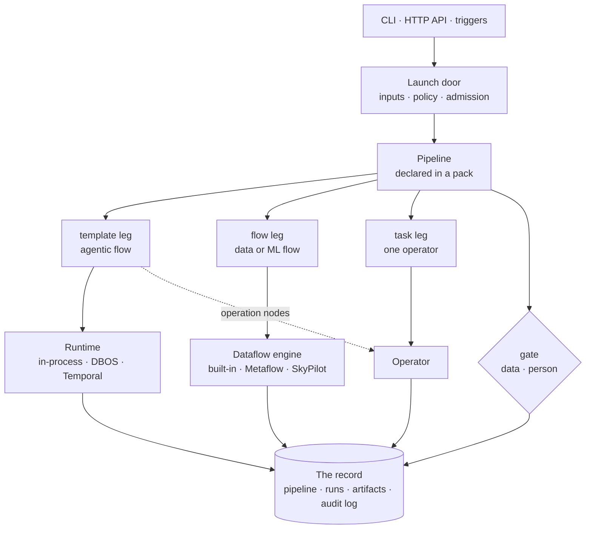

You launch a pipeline. cairn checks it, runs it one leg at a time, hands each
leg to whatever does the work, and writes down what happened. This page is the
map; each part has its own page.

## One door

`cairn run`, `POST /start` on the HTTP API and a trigger (a schedule, a
webhook, a watch or an event) all start a pipeline through the same launch
code. It resolves the reference, checks the inputs, applies policy, runs the
admission checks and only then writes a record. A launch it refuses leaves no
pipeline record behind. [The launch door](/concepts/pipelines/#the-launch-door)
lists the steps.

## Only a declared pipeline runs

A **pipeline** is a YAML file in a [pack](/concepts/glossary/#pack): the legs to
run, the order, and the gates between them. It is the one thing you can
launch. A flow or an operator cannot be started by itself. Asking
to start a flow is refused, and the message tells you to wrap it in a one-leg
pipeline ([Flows](/concepts/flows/#a-pipeline-wraps-a-flow)).

The one exception is the dev loop for agentic flows: `cairn run <flow> --mock`
(also `--dry-run` and `--interactive`) runs in your terminal and writes no
pipeline record and no run.

## Every leg is its own run

A pipeline is a list of **legs**. There are three kinds that do work, plus
gates and loops, which do not:

| Leg | What it runs | Who carries it out |
|---|---|---|
| `template:` | an agentic flow (markdown: a prompt, or a state machine of nodes) | the **runtime**: in-process (the default), DBOS or Temporal, set with `CAIRN_RUNTIME` |
| `flow:` | a data or ML flow (a list of stages) | the **dataflow engine** the environment picks: the built-in one, Metaflow or SkyPilot |
| `task:` | one operator, called directly | the **operator** the environment binds to that capability |
| `gate:` | nothing: it decides whether the next legs may run | data, or a person |
| `loop:` | a group of legs, repeated until a condition holds | the pipeline, with a hard limit |

Each working leg becomes a **run** of its own, with its own status, inputs and
cost, launched through the same admission checks as any other run. A gate has
no run; its verdict and approver are stored on the pipeline.
[Pipelines, legs and steps](/concepts/pipelines/) has the details.

The agentic flow's `operation` nodes call operators too, so an operator can run
under a `task:` leg or inside a `template:` leg. Either way, every operator call
passes the approval check first. A flow leg is checked once, on the highest
risk among its stages. [Gates and approvals](/concepts/gates/) covers what the
check asks.

## The environment chooses the tools

A pipeline says what kind of work a step needs. The **environment** (a profile)
decides which operator provides it, and which dataflow engine runs data and ML
flows. The same pipeline can run against local stand-ins on a laptop and real
providers in a deployment without changing.
[Capabilities and environments](/concepts/capabilities/) shows the bindings.

Where cairn keeps its state (`CAIRN_STORAGE`) and which runtime it uses
(`CAIRN_RUNTIME`) are set on the cairn server, not in the pipeline. See
[Choose the backends](/install/#choose-the-backends).

## Money and approvals

A pipeline declares a budget; a flow leg
**reserves** its estimate against the budget's series before its engine starts,
and a leg whose estimate does not fit fails before it spends. A template's own
cap on model calls is checked after each call, so the call that crosses it has
already been paid for. [Cost and budgets](/concepts/cost/) has the exact
behaviour. Gates are the other check: a pipeline stops at a gate until data or
a person says go, and a policy can add a gate, or refuse the launch, without
the pipeline author's help.

## The record

Everything above leaves something you can read back:

- a **pipeline record** with the plan as resolved at launch, the inputs, and
  each leg's state, run id and gate verdict;
- a **run** for each working leg, with its status, results and cost;
- **artifacts**: the outputs an engine reports, registered by content hash;
- an **audit log**, when the environment turns it on: a hash-chained file of
  security-relevant events. It records the governed steps of a pipeline and
  some calls, not every model call: a template's prompt and agent nodes write
  no row yet.

A paused pipeline is stored, not held in memory.
[Runs and the record](/concepts/runs/) says what is kept and how to read it.

## Next

- [Glossary](/concepts/glossary/): every term on this page, in one list.
- [Run your first pipeline](/guides/first-pipeline/): see the pieces work.
- [Write a pipeline](/guides/write-a-pipeline/): build one step by step.
