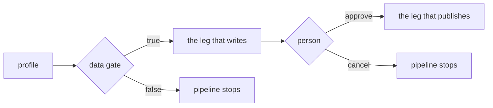

A **gate** is a leg of a pipeline that does no work. It decides whether the
legs after it may run. Every gate has exactly one way of being answered:

- **by data**: an expression over the pipeline's inputs and earlier legs'
  outputs, decided the moment those exist;
- **by a person**: the pipeline pauses until someone approves.

Two more sources add approvals the pipeline author didn't write: **operators**
that ask for approval on every call, and **policies** in the environment.



## A gate answered by data

A data gate has a `predicate:`. When the legs it depends on finish, the
predicate is evaluated. If it is true the gate passes at once, recorded with
the verdict `data`, and nobody is asked. If it is false the pipeline stops:
the gate fails closed (`gate_blocked`), and the legs after it never start.

From the example pack's `profile-and-publish` pipeline, which checks a dataset
before anything else touches it:

```yaml
steps:
  - id: profile
    task: data/profile
    with:
      source: $input.path
      expectation: $input.expectation

  - gate: data-ok
    depends_on: [profile]
    predicate: steps.profile.verdict == 'pass' && steps.profile.record_count >= input.min_rows
```

Because nobody approves a data gate, nobody can approve a run past it. Use one
for anything a number can decide: a cost limit, a minimum count of rows, a
held-out loss (`tiny-finetune` stops when its loss is above `target_loss`).

## A gate answered by a person

A person gate has no `predicate:`. When it becomes ready, the pipeline pauses
with the gate `awaiting_approval`. From the same pipeline:

```yaml
  - gate: review
    depends_on: [stage]
    approvers: data-owners
    show:
      - profile.verdict
      - profile.record_count
      - redact.span_count
      - redact.text
      - stage.uri
```

- **`show:`** lists what the approver sees next to the decision: inputs or
  outputs of earlier legs, written as `<step>.<field>`. Entries that aren't in
  that form are rejected when the pipeline loads, so an approver never faces a
  field that can't resolve.
- **`approvers:`** names who may decide. A gate without one takes the
  pipeline's `governance.approvers`.
- **The pause is durable.** The gate's state lives in the pipeline's record, so
  a restart of the server resumes the pipeline at the same pause.
- **Approving** releases the gate and records who approved, when, and any
  rationale: `cairn remote advance <pipeline_id> <gate>`, or
  `POST /pipelines/<pipeline_id>/steps/<gate>/approve`.
- **Rejecting** refuses the gate, with the person and the reason on the record:
  `cairn remote reject <pipeline_id> <gate> --reason "…"`, or
  `POST /pipelines/<pipeline_id>/steps/<gate>/reject` with `{"reason": "…"}`.
  The same people may reject who may approve, and the reason is required. The
  gate's step ends `skipped` with the verdict `rejected` and the person as its
  approver; the pipeline ends `failed` with the reason `step '<gate>' rejected by
  <person>: <reason>`, after any `finally:` steps have run; the gate's review is
  closed as rejected; and a `pipeline.rejected` event is published. Only a gate
  waiting for approval can be rejected; any other wait answers 409. A cancel is
  different: `cairn remote cancel-pipeline <pipeline_id>` is the operator's abort,
  not a decision on a gate.

A gate can't have both `predicate:` and `approvers:`: the pipeline is refused
at load with "a gate is answered by data OR a human, never both". If you need
both, write two gates, the data gate first. Then a person is only asked about
runs the numbers already allow.

### Who decides

With sign-in on, the decision is recorded under the identity of the person
signed in, never a name typed into the request. `approvers:` holds usernames
or roles (`owner`, `admin`, `member`). Someone it names may decide, and an
owner or admin always may. A name that is neither a user nor a role matches
nobody, so only an owner or admin can decide that gate. Anyone else is refused,
and the refusal is audited.

## Gates an environment adds

A policy can require a gate that isn't in the pipeline file and that the author
can't remove. A policy whose `applies_to.pipeline_legs` globs match a leg is
applied when the pipeline is **planned**, before anything runs:

- `require_hitl` inserts a person gate immediately before every matching leg;
- `deny` refuses the launch outright, naming the policy.

```yaml
name: review-before-fine-tune
applies_to:
  pipeline_legs: ["*/lora"]     # globs over leg refs: the flow hello-cairn/lora, the task train/lora
rules:
  - effect: require_hitl
    approval_role: ml-leads     # optional: who may decide the inserted gate
    reason: a person approves every fine-tune before it starts
```

The inserted gate carries the name of the policy that added it, so the approver
and the audit trail see why it exists. If the rule sets `approval_role`, that is
the gate's `approvers`, and the approve door applies it like any other
`approvers:` value (see above). Without one, the gate takes the pipeline's
`governance.approvers`.

The policy's gate is satisfied only by its own decision. A leg that already sits
behind a person gate isn't gated twice, but only when that gate always asks (it
has no `when:`) and, if the rule sets `approval_role`, is staffed by that role.
A gate with a `when:` can be skipped, so the policy's gate is inserted as well.

`pipeline_legs` is matched when the pipeline is planned, and only then. A policy
that sets nothing but `pipeline_legs` does not apply to individual operator
calls; add `action_types`, `risks`, `environments` or `capabilities` to match
those too.

## Approvals an operator asks for

Some operators are risky enough that they ask for approval themselves: the
operator's manifest marks it `requires_approval`, or a policy that matches the
call (by `action_types`, `risks` or `environments`) says `require_hitl`. Every
operator call passes this check, whichever pipeline it runs in.

In the example, `artifact/promote` moves a governed tag, and it asks on every
call. That is why `profile-and-publish` stops a second time, at `promote`,
after the `review` gate. The example's policy does the same for every
`storage/put` in the `hello-prod` environment:

```yaml
name: hello-require-review-on-publish
applies_to:
  action_types: [storage/put]
  environments: [hello-prod]
rules:
  - effect: require_hitl
    reason: "a write in hello-prod needs a person's approval (hello-cairn policy)"
```

An environment can also ask for every operator of a risk class at once, in its
`profile.toml`. Each operator's manifest declares its `risk`: `read_only`,
`external_write`, `production_mutation` or `paid_compute`.

```toml
[profile.approval]
mode            = "enforce"            # or "off"
default_on_risk = ["paid_compute", "production_mutation"]
```

A typo in this table (an unknown key, mode or risk class) stops the profile
from loading, so a misspelling never leaves the gate off.

A task leg paused this way is approved with the same
`cairn remote advance`. An approval inside an agentic flow pauses its run;
decide it with `cairn remote approve <run_id>` or `cairn remote reject <run_id>`
(a single run id: the run-level form, not the pipeline gate form above).

## Next

- [Cost and budgets](/concepts/cost/): budgets, series and the gates that read prices.
- [Runs and the record](/concepts/runs/): where every decision is kept.
- [Pipeline and flow YAML](/reference/yaml/): every gate field.
