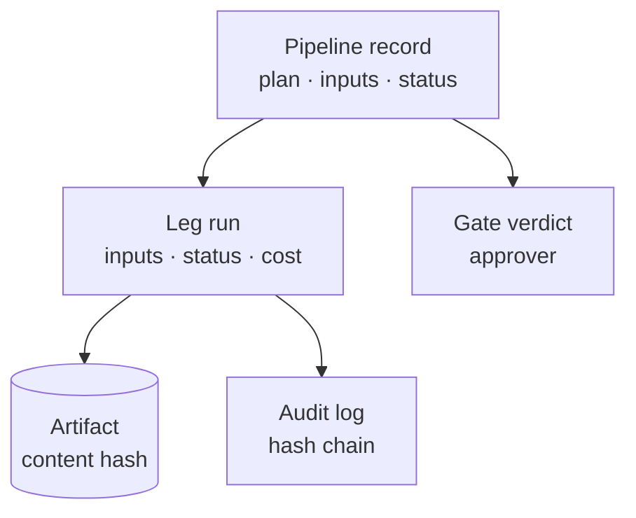

Everything cairn launches leaves a record you can read later: what ran, with
which inputs, in which environment, who approved it, what it produced and what
it cost.



## The pipeline record

Each launch writes one pipeline record (`pl_…`). It holds:

- the **plan**: the legs and gates exactly as resolved at launch, including any
  gate a policy added;
- the **inputs**, the **environment**, what triggered it, and its governance
  (budget, series, approvers);
- for every leg: its status, the id of its run, the gate verdict and the
  approver, and when it started, waited and ended;
- the pipeline status: `queued`, `running`, `paused`, `done`, `failed` or
  `cancelled`.

A paused pipeline is stored, not held in memory. After a restart cairn picks up
the running and paused pipelines again; a gate that was waiting is still
waiting. A leg that was running is a different matter: in the crash cells, a flow
leg on the builtin engine fails and its pipeline fails, and only a template leg
on DBOS resumes.
[What happens when the server is killed](https://github.com/cairndev-sh/cairn/blob/main/benchmark/README.md#what-happens-when-the-server-is-killed)
says what each cell checks and what no cell tests.

## Leg runs

Every flow, template or task leg is its own run. A run records the flow or
operator it ran (fixed when the run was admitted, never worked out again
later), its inputs and environment, its status, its results, and its cost split
into model calls, GPU and storage. A run can name the run it was derived from,
so a chain such as evaluate, fix, fine-tune, promote stays linked.

## Artifacts

An engine never sends rows back to cairn. It returns a description of each
output (its location, kind, content hash, size, row count, schema and the
artifacts it came from), and cairn registers that description as an
**artifact**. An artifact's id is its content hash, and the record does not
change once written. Dataset versions and tags sit on top of artifacts, so a
dataset version always points at one exact file.

## The audit trail

With the audit trail on, cairn appends security-relevant events to a log in
which every row carries `sha256(previous hash + row)`. Changing a row, or deleting
one that has rows after it, breaks the chain at that row, unless the hashes are
recomputed; [Verify the audit trail](#verify-the-audit-trail) lists what the chain
can't detect. The log records operator approvals inside
flows, `llm_complete` model calls, `mcp/call` tool calls, actions, and every governed
step of a pipeline run, listed below. A template's own prompt and agent nodes write
no row yet. The pipeline record and the run events stay the place to replay a run; the
log is the part that is tamper-evident.

The audit trail is part of the environment: it is on when the profile binds
`audit.sink` to the `audit/store` operator. The `secure` profile does, and so
do the Docker Compose stack and the example's `hello.toml`, which the Quickstart
uses; `sandbox` and `local-dev` do not. A pipeline
can also write an audit row as a leg of its own, as the example's
`profile-and-publish` does with `task: audit/store`. The log file is
`CAIRN_AUDIT_LOG` (`./audit.jsonl` when unset).

### What a pipeline run writes

Each row names an `action`, an `outcome` (`ok`, `deny` or `error`), the `actor`
where a person acted (the signed-in identity, never a name typed into a request),
a `target` (`<pipeline id>/<step>`) and ids, refs, states and amounts in its
metadata. Inputs, outputs, prompts and tokens are never written.

| Action | Written when | Notable fields |
|---|---|---|
| `pipeline.admitted` | the launch door admits a pipeline | `verdict`, `degrading_reasons`, `estimated_usd`, `budget_usd`, `source` |
| `pipeline.refused` | the launch door refuses (data roles, holdout, licence, policy deny, service door, run hook, the GPU estimate or the budget) | `reasons`, `refusal`, outcome `deny` |
| `pipeline.gate_approved` | a person releases a gate (`actor`); `pipeline.step_advanced` when a manual, schedule or event wait is released with no named person | `step_id`, `wait`, `owner` |
| `pipeline.gate_rejected` | a person rejects a gate (`actor`) | `reason`, outcome `deny` |
| `pipeline.cancelled` | a pipeline is cancelled (`actor`) | `prior_status` |
| `approval.expired` · `approval.dismissed` | the TTL sweep expires a waiting approval · a person dismisses it (`actor`) | `run_id`, `pipeline_id`, `reason` |
| `leg.submitted` | a leg exists as its own run | `ref`, `kind`, `engine`, `compute_target`, `estimated_usd` |
| `leg.retrying` | a flow leg starts another attempt | `attempt`, `reason` |
| `leg.budget_refused` | the leg's reservation would pass the series cap | `estimated_usd`, `spent_usd`, `budget_usd`, outcome `deny` |
| `leg.finished` | a leg ends: `done`, `failed`, `cancelled` or `skipped` | `state`, `reason`, `attempts`, `engine`, `compute_target`, `settled_usd`, `llm_usd`, `gpu_usd` |
| `leg.compute_acquired` · `leg.compute_released` · `leg.promoted` | a `compute/acquire`, `compute/release` or `artifact/promote` leg succeeds | `operator`, `capability` |
| `leg.cancelled` · `run.cancelled` | `POST /runs/{id}/cancel` stops a leg's run · any other run (`actor`) | `prior_status` |
| `pipeline.finished` | a pipeline reaches `done`, `failed` or `cancelled` | `state`, `reason`, `spent_usd`, `budget_usd` |

The in-process owner (also used under `CAIRN_RUNTIME=dbos`) and the Temporal owner write
the same rows; under Temporal they are written by activities, never by the workflow.
With no `audit.sink` bound none of this is written and nothing else changes.

### Verify the audit trail

`cairn admin audit verify` recomputes every row's hash from the one before it and
reports whether the chain holds. It only reads the log, and it needs no lineage
records:

```console
$ cairn admin audit verify
audit log: audit.jsonl
  rows:      412
  first ts:  2026-10-28T09:01:12+00:00
  last ts:   2026-10-28T11:47:03+00:00
  head hash: 9c1f6e0b47d2a8353fe1c07ab96d4e12087fb35ac1de6490b2738f5ea1c4d07e
chain OK
```

It reads `--audit-log`, else `CAIRN_AUDIT_LOG`, else `./audit.jsonl`. When the
chain is broken it names the first broken row and why (`hash`, `prev_hash` or
`corrupt line`). `--json` prints `{path, rows, first_ts, last_ts, head_hash, ok,
broken}`. The exit code is 0 when the chain verifies (an empty log verifies, with
zero rows), 2 when it is broken or has a corrupt line, and 1 when there is no log
or it cannot be read, so a CI job can gate on it.

"Tamper-evident" has a narrow meaning here. When rows inside the log are altered
and the hashes are left as they were, the command names the row it broke:

| Altered | Result | Row named |
|---|---|---|
| A field in a row | exit 2, `hash` | that row |
| A row deleted, with rows after it | exit 2, `prev_hash` | the row now in its place |
| A forged row inserted before other rows, linked correctly to the row before it | exit 2, `prev_hash` | the row after the forgery |
| Two neighbouring rows swapped, with a row after them | exit 2, `prev_hash` | the first of them, then the two rows after it |

It does not mean the log can't be rewritten. The chain has no key and nothing
outside the file to compare with, so anyone who can write the file can recompute
the hashes. These all exit 0 from `cairn admin audit verify`:

- a forged row appended at the end, linked correctly to the last row
- the last rows cut off, or the whole file emptied (an empty log verifies)
- a row changed and every hash after it recomputed
- the whole file rewritten, with every hash recomputed

To detect them, save the head hash (`head_hash` in the `--json` output) somewhere
the log's writer can't reach, and check the log against it:

```console
$ saved="$(cat saved-head)"
$ test "${#saved}" -eq 64 && cairn admin lineage --json --audit-log audit.jsonl --expect-head "$saved"
```

A log that no longer ends at that hash exits 2, with `chain_ok: false`. How you
call the check matters:

- **Use the full 64-character hash.** `--expect-head` also accepts a prefix of at least 12
  characters, but a prefix is a weaker check. An empty or shorter value is refused with exit 2.
- **Don't let the value come out empty.** An empty or blank value compares nothing, so
  a log with rows cut exits 0. The `test` above refuses one.
- **Pass `--json`.** Without it, a log with no lineage records exits 1 even when the
  head matches, and a public install writes no lineage records.

A saved head has limits of its own:

- It only covers the rows written before you saved it. Rows added later and then cut
  go unnoticed even with that head.
- An exit 2 doesn't say why. A log that only grew and a log with a forged row appended
  get the same answer, and `cairn admin audit verify` exits 0 on both, so neither
  command can tell them apart. A new head you save vouches for every row before it,
  a forgery included, so check the rows added since the last head some other way
  before you save it.

[`benchmark/audit_tamper.py`](https://github.com/cairndev-sh/cairn/blob/main/benchmark/audit_tamper.py)
runs these cases on a log a real engine wrote, altering it in the middle and at the
end, and fails if one of them answers differently. Its result lists each case it ran.

## Reading it back

| Where | What you get |
|---|---|
| `cairn status <id> --json` | a pipeline's full record from a server, as JSON: plan, inputs, governance, every step's state |
| `cairn status <id> --results` | every leg's outputs for a pipeline |
| `cairn status` · `cairn status <run-id>` · `cairn status <run-id> --logs` | the runs on a server, one run's record, its event log |
| `cairn status <run-id> --replay` | a past run's recorded event trace, rendered as a timeline; it does not run anything again |
| `cairn admin audit verify` | whether the audit log's hash chain holds, with the row count, first and last timestamp and head hash |
| `cairn admin lineage [subject]` | lineage records in the audit log, with the hash chain checked as it reads |
| `GET /pipelines/<id>` · `GET /pipelines/<id>/findings` | the same over the HTTP API |

The operator that writes lineage records is part of cairn-platform, as is the
console's pipeline and run pages.

## Next

- [Gates and approvals](/concepts/gates/): how verdicts get onto the record.
- [Cost and budgets](/concepts/cost/): how cost is capped and recorded.
- [CLI reference](/reference/cli/): the commands above in full.
