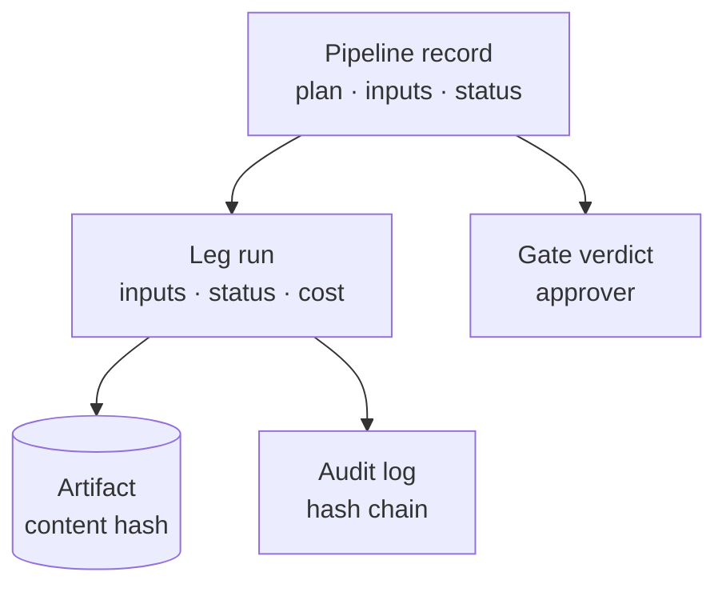

Everything cairn launches leaves a record you can read later: what ran, with
which inputs, in which environment, who approved it, what it produced and what
it cost.



## The pipeline record

Each launch writes one pipeline record (`pl_…`). It holds:

- the **plan**: the legs and gates exactly as resolved at launch, including any
  gate a policy added;
- the **inputs**, the **environment**, what triggered it, and its governance
  (budget, series, approvers);
- for every leg: its status, the id of its run, the gate verdict and the
  approver, and when it started, waited and ended;
- the pipeline status: `queued`, `running`, `paused`, `done`, `failed` or
  `cancelled`.

A paused pipeline is stored, not held in memory. After a restart cairn picks up
the running and paused pipelines again; a gate that was waiting is still
waiting.

## Leg runs

Every flow, template or task leg is its own run. A run records the flow or
operator it ran (fixed when the run was admitted, never worked out again
later), its inputs and environment, its status, its results, and its cost split
into model calls, GPU and storage. A run can name the run it was derived from,
so a chain such as evaluate, fix, fine-tune, promote stays linked.

## Artifacts

An engine never sends rows back to cairn. It returns a description of each
output (its location, kind, content hash, size, row count, schema and the
artifacts it came from), and cairn registers that description as an
**artifact**. An artifact's id is its content hash, and the record does not
change once written. Dataset versions and tags sit on top of artifacts, so a
dataset version always points at one exact file.

## The audit trail

With the audit trail on, cairn appends security-relevant events to a log in
which every row carries `sha256(previous hash + row)`. Changing or deleting a
row breaks every hash after it. The log records operator approvals inside
flows, model calls and actions, and every governed step of a pipeline run, listed
below. The pipeline record and the run events stay the place to replay a run; the
log is the part that is tamper-evident.

The audit trail is part of the environment: it is on when the profile binds
`audit.sink` to the `audit/store` operator. The `secure` profile does, and so
does the Docker Compose stack; `sandbox` and `local-dev` do not. A pipeline
can also write an audit row as a leg of its own, as the example's
`profile-and-publish` does with `task: audit/store`. The log file is
`CAIRN_AUDIT_LOG` (`./audit.jsonl` when unset).

### What a pipeline run writes

Each row names an `action`, an `outcome` (`ok`, `deny` or `error`), the `actor`
where a person acted (the signed-in identity, never a name typed into a request),
a `target` (`<pipeline id>/<step>`) and ids, refs, states and amounts in its
metadata. Inputs, outputs, prompts and tokens are never written.

| Action | Written when | Notable fields |
|---|---|---|
| `pipeline.admitted` | the launch door admits a pipeline | `verdict`, `degrading_reasons`, `estimated_usd`, `budget_usd`, `source` |
| `pipeline.refused` | the launch door refuses (data roles, holdout, licence, policy deny, service door, run hook, the GPU estimate or the budget) | `reasons`, `refusal`, outcome `deny` |
| `pipeline.gate_approved` | a person releases a gate (`actor`); `pipeline.step_advanced` when a manual, schedule or event wait is released with no named person | `step_id`, `wait`, `owner` |
| `pipeline.gate_rejected` | a person rejects a gate (`actor`) | `reason`, outcome `deny` |
| `pipeline.cancelled` | a pipeline is cancelled (`actor`) | `prior_status` |
| `approval.expired` · `approval.dismissed` | the TTL sweep expires a waiting approval · a person dismisses it (`actor`) | `run_id`, `pipeline_id`, `reason` |
| `leg.submitted` | a leg exists as its own run | `ref`, `kind`, `engine`, `compute_target`, `estimated_usd` |
| `leg.retrying` | a flow leg starts another attempt | `attempt`, `reason` |
| `leg.budget_refused` | the leg's reservation would pass the series cap | `estimated_usd`, `spent_usd`, `budget_usd`, outcome `deny` |
| `leg.finished` | a leg ends: `done`, `failed`, `cancelled` or `skipped` | `state`, `reason`, `attempts`, `engine`, `compute_target`, `settled_usd`, `llm_usd`, `gpu_usd` |
| `leg.compute_acquired` · `leg.compute_released` · `leg.promoted` | a `compute/acquire`, `compute/release` or `artifact/promote` leg succeeds | `operator`, `capability` |
| `leg.cancelled` · `run.cancelled` | `POST /runs/{id}/cancel` stops a leg's run · any other run (`actor`) | `prior_status` |
| `pipeline.finished` | a pipeline reaches `done`, `failed` or `cancelled` | `state`, `reason`, `spent_usd`, `budget_usd` |

The in-process owner (also used under `CAIRN_RUNTIME=dbos`) and the Temporal owner write
the same rows; under Temporal they are written by activities, never by the workflow.
With no `audit.sink` bound none of this is written and nothing else changes.

### Verify the audit trail

`cairn audit verify` recomputes every row's hash from the one before it and
reports whether the chain holds. It only reads the log, and it needs no lineage
records:

```console
$ cairn audit verify
audit log: audit.jsonl
  rows:      412
  first ts:  2026-10-28T09:01:12+00:00
  last ts:   2026-10-28T11:47:03+00:00
  head hash: 9c1f…
chain OK
```

It reads `--audit-log`, else `CAIRN_AUDIT_LOG`, else `./audit.jsonl`. When the
chain is broken it names the first broken row and why (`hash`, `prev_hash` or
`corrupt line`). `--json` prints `{path, rows, first_ts, last_ts, head_hash, ok,
broken}`. The exit code is 0 when the chain verifies (an empty log verifies, with
zero rows), 2 when it is broken or has a corrupt line, and 1 when there is no log
or it cannot be read, so a CI job can gate on it. The check proves that no row was
changed, removed from the middle or reordered; it cannot tell that rows were cut
off the end, so keep the head hash somewhere else if you need that.

## Reading it back

| Where | What you get |
|---|---|
| `cairn remote pipeline <id>` | a pipeline's full record from a server, as JSON: plan, inputs, governance, every step's state |
| `cairn remote findings <id>` | every leg's outputs for a pipeline |
| `cairn remote ps` · `cairn remote status <run-id>` · `cairn remote logs <run-id>` | the runs on a server, one run's record, its event log |
| `cairn replay <run-id>` | a past run's recorded event trace, rendered as a timeline; it does not run anything again |
| `cairn audit verify` | whether the audit log's hash chain holds, with the row count, first and last timestamp and head hash |
| `cairn lineage [subject]` | lineage records in the audit log, with the hash chain checked as it reads |
| `GET /pipelines/<id>` · `GET /pipelines/<id>/findings` | the same over the HTTP API |

The operator that writes lineage records is part of cairn-platform, as is the
console's pipeline and run pages.

## Next

- [Gates and approvals](/concepts/gates/): how verdicts get onto the record.
- [Cost and budgets](/concepts/cost/): how cost is capped and recorded.
- [CLI reference](/reference/cli/): the commands above in full.
