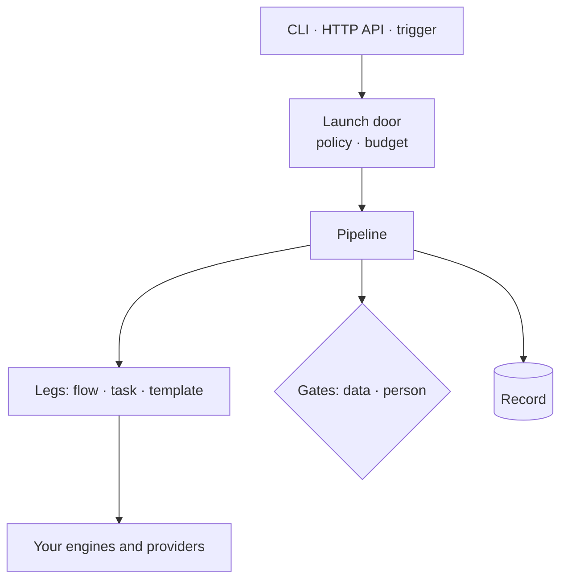

cairn is a self-hosted control plane for the work behind AI models: preparing
datasets, fine-tuning, evaluating and running jobs against models. It decides
when each step may run, holds the spend to a budget, pauses for a data check
or a person, and keeps a record of what happened. Your engines and providers
do the work.

## The problem

Work on models spends money and changes things. A fine-tune buys GPU hours, a
batch job buys tokens, and a promoted model or a new dataset version is what
other people build on next.

So the same questions come up every time. Before a run: what will it cost,
and who agreed to it? After a run: what ran, on which data, who approved it,
and what did it cost? Without a control plane the answers live in scripts,
notebooks and memory.

## What cairn does

You describe the work as a **pipeline**: a YAML file that lists the legs to
run, their order, and the gates between them. cairn then does five things.

- **One launch door.** The CLI, the HTTP API and a trigger all start a
  pipeline through the same code. Policy can add a gate, or refuse the launch,
  before anything is recorded.
- **Every leg is its own run.** cairn hands each leg to the engine or operator
  that does the work, then tracks its status and cost.
- **Gates.** A gate is answered by data (a predicate over earlier results) or
  by a person. A waiting gate is stored, so it survives a restart.
- **Budgets.** A pipeline declares a spending cap, and flow legs reserve their
  estimate against it before they start. A data gate can stop a pipeline on
  any number an earlier leg produced, such as a price.
- **The record.** Each pipeline keeps its plan, its inputs, the run behind
  every leg, and every gate's verdict and approver. Outputs are registered as
  content-addressed artifacts.

## What cairn does not replace

cairn orchestrates and governs. The work itself runs on tools you choose.

| Work | Runs on |
|---|---|
| Data processing | a dataflow engine: the built-in one, or Metaflow (`cairndev[metaflow]`) or SkyPilot (`cairndev[skypilot]`) |
| Training | the built-in `train/lora` operator fine-tunes a small model on CPU; other training backends come as operator packs |
| Model calls | any OpenAI-compatible endpoint, directly or through a LiteLLM gateway |
| Durable execution | the in-process runtime, DBOS or Temporal |
| State | SQLite or Postgres |

The web console, and the operator packs for GPU providers and managed
training, are part of cairn-platform. Everything on this site runs with the
open-source `cairndev` package.

## Words used in these docs

| Word | Meaning |
|---|---|
| Pipeline | The thing you launch: a YAML file of legs and gates. |
| Leg | One step of a pipeline. A leg that does work is its own run. |
| Flow | A component a leg runs: a data or ML stage list, or an agentic markdown flow. |
| Step | A stage or node inside a flow. |
| Gate | A leg that stops the pipeline until data or a person says go. |
| Environment | Where a pipeline runs, and which operator does each kind of work there. |
| Operator | The code that talks to one tool or provider. |
| Pack | A directory (or installed package) that holds pipelines, flows and policies. |

## Next

- [Quickstart](/quickstart/): install cairn, launch a pipeline and approve a gate.
- [Pipelines, legs and steps](/concepts/pipelines/): the model in more detail.
- [Install and deploy](/install/): run cairn for your team.
- [Live demo](https://demo.cairndev.sh): try cairn without installing anything (a shared sandbox, so don't enter real credentials).
